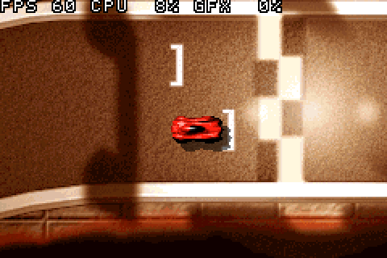
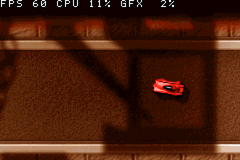
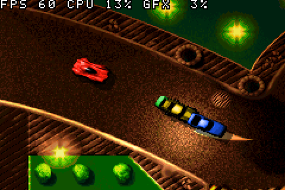
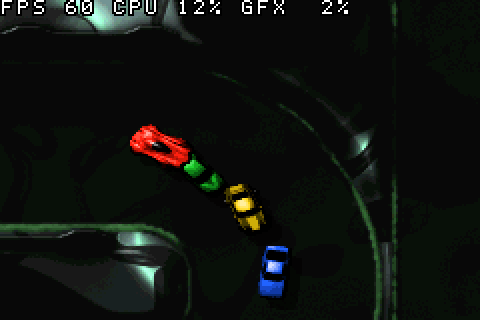

# Death Rally Advance: _Death Rally_ on the Game Boy Advance

A fork of [**dRally**](https://github.com/urxp/dRally) by Neomalius (urxp)

dRally is an open-source engine for _Death Rally_ (1996), rebuilt from the original executable, that runs natively on Linux and BSD. **Death Rally Advance** reorganizes its source into modules and starts a port to **the Game Boy Advance**, as a cartridge ROM with the game data built in.

This is an early work in progress. On the GBA you can now **drive a race run by the game's own race code**, against the game's AI, on one track: `gba/race`. It draws the race with the GBA's tile and sprite hardware, mostly at 60 frames per second. The race still starts from one recorded by the desktop game, and there are no menus, sound, skid marks or explosions yet. See [Status](#status).

## Game Data

No game data is included. You need the files from the original _Death Rally_. The port has been developed with the free registered Windows version, see [Installation](#installation).

The GBA build puts the game data inside the ROM, so a ROM carries the same restrictions as the data files it was built from: **don't share ROMs**.

## Game Boy Advance

### Screenshots

| | |
|:-:|:-:|
|  |  |
| The start grid of the first track | Racing, with the frame rate meter on top |
|  |  |
| Track 3, with the other cars on autopilot | Track 10 |

Screenshots are taken in mGBA and shown at twice the GBA's resolution.

### What the Prototype Does

`gba/proto` tests whether the GBA can draw a race:

* The track is a 256-color tile background streamed from ROM through a ring of tiles, so tracks of any size scroll without being loaded into RAM.
* The four cars are hardware sprites, using the game's own 96 rotation frames and body colors.
* Car shadows are drawn by the OBJ window with the darken effect, instead of by drawing pixels.
* Cars stay on the road using the track's mask, the same one the game uses for its walls.

The driving, the collisions and the other cars' autopilot are simple stand-ins. None of the game's race code runs on the GBA yet.

In mGBA all ten tracks run at 60 frames per second using about 12% of each frame, of which at most 9% is graphics. That leaves most of the frame for the game's own race code, which is the next thing to measure. The prototype hasn't been tested on real hardware yet.

### The Race Code on the GBA

`gba/replay` runs the game's own race logic, `race_logic()` in `src/race/race_logic.c`, on the GBA. It replays a race recorded by the desktop game and times every frame:

```sh
make ticklog                 # a desktop build that records the first race to game/TICKLOG.BIN
cd game && ../build/ticklog/drally_ticklog && cd ..   # start one race, the AI drives your car
make -C gba/replay           # builds gba/replay/drreplay.gba from game/TICKLOG.BIN
make -C gba/replay PROFILE=1 # also times each part of the logic and counts the soft-float calls
```

For each frame the recording holds what changed in the logic's globals before it ran (the input, the timer and what the renderer touched) and a hash of the globals after it. The GBA applies the changes, runs the logic and compares hashes. The track maps and car images are read straight from ROM, as they will have to be in the port.

Results in mGBA, for a whole 4-lap race (10,821 frames) with the AI driving all four cars:

* **The GBA computes exactly the same race as the desktop build of the same code.** Every frame's hash matches.
* **A tick of the logic takes 193,000 cycles on average, 211,000 in the busiest 1,000 frames.** The original code took 3.9 million. The game runs its logic 70 times a second, so 60 frames per second needs a tick in about 200,000 cycles, with room left for drawing. That target is met now. Only one frame of the race that runs a single tick takes longer than a GBA frame.
* **How it got there:** `sin()` and `cos()` from a table, libgcc's soft-float in IWRAM, a map of where the walls are, single precision instead of double in the physics, AI and skid marks, cheaper searches, and the innermost loops as ARM code in IWRAM. Each step was checked against the replay. The steps that changed the math were also checked against how the race comes out (see below).

`tools/replay` replays a recording on the desktop. It prints each car's finish frame and place and a hash of the track image, and it can write the recording again with the current build's hashes, which is what the GBA then checks against. The finish frames tell whether a change to the math changed the driving: rounding one constant differently moves them by about 50 frames.

The details, and what is left to do, are in [docs/gba-race-speed.md](docs/gba-race-speed.md).

### A Race on the GBA

`gba/race` puts the two together: the game's race code runs the race, and the GBA draws it the way `gba/proto` does. Each frame it does what the desktop game's race loop does:

* The GBA's buttons become the keyboard state that the game's 70 Hz timer interrupt (`race___40164h()`) turns into your car's controls.
* `race_logic()` runs the ticks that are due, with the AI driving the other three cars.
* `race_render()` keeps the camera, animations, lap times and other state that the desktop updates while drawing. Built with `DR_RACE_NODRAW`, it skips the drawing itself. A desktop check (`DR_CHECK_NODRAW=1` in a `make ticklog` build) runs every frame of a race both ways and finds no difference in the race.
* The cars' sprites come from their positions and rotation frames in the game's car structs, and the camera from the game's own look-ahead.

The starting grid, car images and other race state come from a race recorded by the desktop game (see above). `tools/gbabake` bakes them into the ROM with the track.

In mGBA a whole race runs at 56 frames per second on average. Most seconds run at a full 60, and a few busy ones, with all four cars close together, drop to 30-35. When a frame runs long the game slows down rather than skipping ticks. To keep the game at 60 frames per second it runs one tick a frame by default, so it plays at 6/7 of its real speed. `make TICKS=70` gives the real speed and drops more frames.

### Building

Requirements:

* The devkitPro GBA toolchain. Install devkitPro's pacman (see [Getting Started](https://devkitpro.org/wiki/Getting_Started)), then run `sudo dkp-pacman -S gba-dev`.
* A C compiler for Linux, to build `tools/gbabake`, which turns the game data into the layouts the ROM uses.
* The game data in `game/` (or pass `GAME=/path/to/game`).

```sh
make -C gba/proto            # builds gba/proto/drproto-tr0.gba
make -C gba/proto TRACK=5    # any track, 0-9
make -C gba/race RACE=game/TICKLOG.BIN TRACK=8   # a race, from a recording made on that track
```

Each prototype ROM holds one track and is about 3 MB, a race ROM about 5 MB. `gbabake` refuses a recording made on another track than `TRACK`.

### Controls

| Button       | Does                                     |
|--------------|------------------------------------------|
| D-pad        | Steer left and right                     |
| A            | Accelerate                               |
| B            | Brake, then reverse                      |
| R            | Let the autopilot drive                  |
| Start        | Back to the start grid                   |
| Select       | Show or hide the frame rate meter        |

The meter shows frames per second, the share of each frame used (CPU) and the part of that spent on graphics (GFX).

In `gba/race`:

| Button       | Does                                     |
|--------------|------------------------------------------|
| D-pad        | Steer left and right                     |
| A            | Accelerate                               |
| B            | Brake                                    |
| R            | Turbo                                    |
| L            | Machine gun                              |
| Select       | Drop a mine                              |
| Start        | Let the AI drive your car, or race again once the race is over |

Its meter shows frames per second and the share of the CPU used. The HUD shows your position and lap.

### Status

Working: drawing any of the ten tracks with four cars and their shadows at 60 frames per second in mGBA, running the game's race logic on the GBA with the same results as the desktop, and driving a race against the game's AI with it.

Not done yet:

* Setting up a race on the GBA itself. It now starts from one the desktop recorded.
* A steady 60 frames per second at the game's real speed. In the busiest stretches a tick of the logic takes up to about 240,000 cycles. One tick a frame needs it under about 225,000, and the game's real 70 ticks a second needs about 190,000.
* Skid marks, wrecks and the track under obstacles, which the race code draws into the track image. The port needs a writable overlay for the tiles they touch.
* Explosions, spectators, mines, shots and the rest of the race's pictures, and the race's own HUD.
* Menus, shops and the underground market, which are drawn at 640x480.
* Music and sound (the S3M and XM songs, through Maxmod).
* Saving in SRAM.
* Testing on real hardware.

## Desktop

### Requirements

* GCC or Clang
* GNU Make
* SDL2
* SDL2_net

On Debian/Ubuntu: `sudo apt install build-essential libsdl2-dev libsdl2-net-dev`

### Building

```sh
make -j$(nproc)
FLAGS="YOUR CFLAGS" make   # custom flags, default is -O3
make check                 # LTO build, fails on mismatched declarations across files
```

### Installation

The game needs the original game assets, for example the [free registered Windows version on CHIP](https://www.chip.de/downloads/Death-Rally-Vollversion_38550689.html):

```sh
7z e -o game DeathRallyWin_10.exe
cd game && mkdir CINEM && mv ENDANI* CINEM && mv SANIM* CINEM
echo "./CINEM" > CDROM.INI
```

Only versions including the DR.IDF file are able to use the `-DDR_CDCHECK` define.

    game
    |--CINEM
    |  |--DR.IDF
    |  |--ENDANI.HAF
    |  |--ENDANI0.HAF
    |  |--SANIM.HAF
    |--CDROM.INI        [1]
    |--ENGINE.BPA
    |--IBFILES.BPA
    |--MENU.BPA
    |--MUSICS.BPA
    |--TR[0-9].BPA

    Make sure these file/dir names in the game directory are in uppercase.

    [1] CDROM.INI contains relative location of CINEM directory (./CINEM)

### Running

```sh
make run            # or ./scripts/drun, ./scripts/drun_gdb for gdb
```

Multiplayer is not available yet.

## Source Layout

    src/core          entry point, system/SDL layer, input, memory, math
    src/gfx           display, palettes, fonts, cinematics
    src/sound         audio mixer, S3M/XM players
    src/data          global data/bss, assets, BPA archives
    src/menu          main menu
    src/race          race engine
    src/shop          shop
    src/underground   underground market
    src/net           multiplayer (IPX over UDP)
    src/dfr           __dfr_* functions
    src/decomp        decompiled functions not yet sorted into a module
    include           headers
    tools/ipxnet      standalone IPX relay server
    tools/gbabake     turns game data into GBA layouts
    gba/proto         Game Boy Advance rendering prototype
    gba/replay        runs recorded races through the race logic on the GBA
    gba/race          a race on the GBA, run by the game's race code
    gba/game.mk       builds the game's code for the GBA, for gba/replay and gba/race
    tools/replay      the same on the desktop, and re-hashes recordings after a math change
    include/nosdl     SDL stand-in for building the game's code without SDL
    scripts           run helpers, discmp.sh to compare generated code

Function files are named after their address in the original executable (e.g. `___3e720h.c`). Keep that name when moving them between modules.

## License

MIT, see [LICENSE](LICENSE).

## Credits

- dRally: Neomalius (urxp)
- Game Boy Advance port: Berobloom
- _Death Rally_ (1996): Remedy Entertainment and Apogee Software
