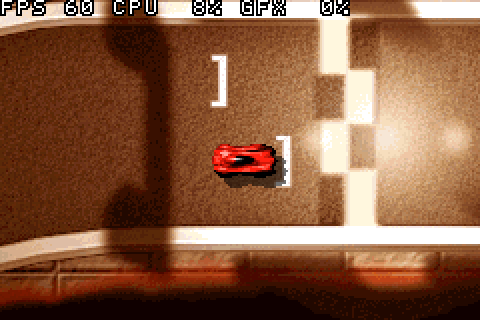
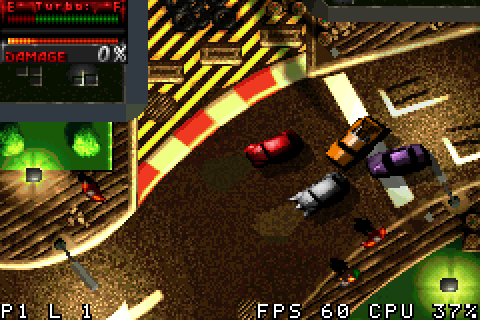
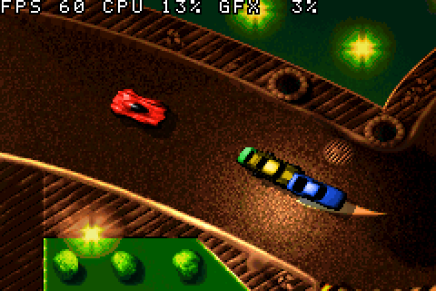
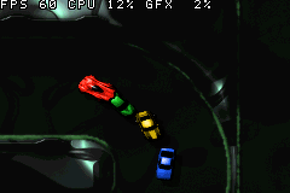

# Death Rally Advance: _Death Rally_ on the Game Boy Advance

A fork of [**dRally**](https://github.com/urxp/dRally) by Neomalius (urxp)

dRally is an open-source engine for _Death Rally_ (1996), rebuilt from the original executable, that runs natively on Linux and BSD. **Death Rally Advance** reorganizes its source into modules and starts a port to **the Game Boy Advance**, as a cartridge ROM with the game data built in.

This is an early work in progress. On the GBA you can now **drive a race run by the game's own race code**, against the game's AI, on any of the ten tracks: `gba/race`. The game's own code sets the race up on the GBA, and the race is drawn with the GBA's tile and sprite hardware at 60 frames per second, at the game's real speed. Skid marks, mines, power-ups and obstacles show on the track, and spectators, wrecks, explosions, shots, the start lights and the finish flag over it. The game's own HUD box shows turbo, ammo, mines and damage. There are no menus or sound yet. See [Status](#status).

## Game Data

No game data is included. You need the files from the original _Death Rally_. The port has been developed with the free registered Windows version, see [Installation](#installation).

The GBA build puts the game data inside the ROM, so a ROM carries the same restrictions as the data files it was built from: **don't share ROMs**.

## Game Boy Advance

### Screenshots

| | |
|:-:|:-:|
|  |  |
| The start grid of the first track | Racing, with the frame rate meter on top |
|  |  |
| Track 3, with the other cars on autopilot | Track 10 |

Screenshots are taken in mGBA and shown at twice the GBA's resolution.

### What the Prototype Does

`gba/proto` tests whether the GBA can draw a race:

* The track is a 256-color tile background streamed from ROM through a ring of tiles, so tracks of any size scroll without being loaded into RAM.
* The four cars are hardware sprites, using the game's own 96 rotation frames and body colors.
* Car shadows are drawn by the OBJ window with the darken effect, instead of by drawing pixels.
* Cars stay on the road using the track's mask, the same one the game uses for its walls.

The driving, the collisions and the other cars' autopilot are simple stand-ins. None of the game's race code runs on the GBA yet.

In mGBA all ten tracks run at 60 frames per second using about 12% of each frame, of which at most 9% is graphics. That leaves most of the frame for the game's own race code, which is the next thing to measure. The prototype hasn't been tested on real hardware yet.

### The Race Code on the GBA

`gba/replay` runs the game's own race logic, `race_logic()` in `src/race/race_logic.c`, on the GBA. It replays a race recorded by the desktop game and times every frame:

```sh
make ticklog                 # a desktop build that records the first race to game/TICKLOG.BIN
cd game && ../build/ticklog/drally_ticklog && cd ..   # start one race, the AI drives your car
make -C gba/replay           # builds gba/replay/drreplay.gba from game/TICKLOG.BIN
make -C gba/replay PROFILE=1 # also times each part of the logic and counts the soft-float calls
```

For each frame the recording holds what changed in the logic's globals before it ran (the input, the timer and what the renderer touched) and a hash of the globals after it. The GBA applies the changes, runs the logic and compares hashes. The track maps and car images are read straight from ROM, as they will have to be in the port.

Results in mGBA, for a whole 4-lap race (10,821 frames) with the AI driving all four cars:

* **The GBA computes exactly the same race as the desktop build of the same code.** Every frame's hash matches.
* **A tick of the logic takes 167,500 cycles on average, 180,000 in the busiest 1,000 frames.** The original code took 3.9 million. The game runs its logic 70 times a second, so 60 frames per second needs a tick in about 200,000 cycles, with room left for drawing.
* **How it got there:** `sin()` and `cos()` from a table, libgcc's soft-float in IWRAM, a map of where the walls are, single precision instead of double in the physics, AI and skid marks, cheaper searches, the innermost loops as ARM code in IWRAM, word loads instead of byte loads, and no library divisions. Each step was checked against the replay. The steps that changed the math were also checked against how the race comes out (see below).

`tools/replay` replays a recording on the desktop. It prints each car's finish frame and place and a hash of the track image, and it can write the recording again with the current build's hashes, which is what the GBA then checks against. The finish frames tell whether a change to the math changed the driving: rounding one constant differently moves them by about 50 frames.

The details, and what is left to do, are in [docs/gba-race-speed.md](docs/gba-race-speed.md).

### A Race on the GBA

`gba/race` puts the two together: the game's race code runs the race, and the GBA draws it the way `gba/proto` does. For each tick of the game's 70 Hz timer it does what the desktop game's race loop does for a frame:

* The GBA's buttons become the keyboard state that the game's timer interrupt (`race___40164h()`) turns into your car's controls.
* `race_logic()` runs the tick, with the AI driving the other three cars.
* `race_render()` keeps the camera, animations, lap times and other state that the desktop updates while drawing. Built with `DR_RACE_NODRAW`, it skips the drawing itself. A desktop check (`DR_CHECK_NODRAW=1` in a `make ticklog` build) runs every frame of a race both ways and finds no difference in the race.
* The cars' sprites come from their positions and rotation frames in the game's car structs, and the camera from the game's own look-ahead.

The race code draws skid marks, mines, craters, power-ups and obstacles into the track image, and reads back the pixels under them. The whole image doesn't fit in the GBA's RAM: TR0's alone is 720 KB. So the race code goes through a small API, `race_ima_read()`, `_write()`, `_draw()` and `_lookup()` in `src/race/race_ima.c`. On the desktop it works on `TRX_IMA` directly. Built with `DR_IMA_TILES`, as `gba/race` is, the image is the track's 8x8 tiles in ROM, with each tile the race draws into copied to a pool of 2,048 in EWRAM (128 KB). A whole race draws into at most about 1,800. The vblank interrupt loads the changed tiles that are on screen. `make -C tools/replay IMA_TILES=n` builds `replay-tiles`, the desktop with the GBA's tiles, for checking the two against each other.

What the race draws over the track, the spectators and their splats, wrecks, explosions, smoke, gun flashes, shots, rockets, the start lights and the finish flag, goes through `race_sprite()` in `src/race/race_render.c` as well as into the desktop's back buffer. On the GBA a callback turns each picture into a hardware sprite, in front of the cars or behind them in the order the game draws them, with up to 40 a frame. The start lights and the finish flag, which waves on the leader's last lap, are 80x60 pictures in two sprites. `tools/gbabake` bakes the 16 picture files into `sprites.bin` (360 KB). It also bakes the lights' 3 frames and the flag's 64 into `lamps.obj`, already laid out as the sprites' tiles, so that a new frame is a single 6 KB DMA copy.

The HUD box at the top left, with the turbo bar, the damage, and the ammo bar and mines (or the lap time in a race without weapons), is drawn by the game's own `race___40864h()`. The time it keeps the last lap's time up and the damage warnings, which it also did, are now in `race___40864h_state()`, which runs whether anything is drawn or not. On the GBA the box is drawn into a buffer that stands in for the back buffer, copied to 32 tiles of the HUD's background layer, with a black layer under it for the box's colour 0. It's drawn again only when a number or bar in it changes, at most 30 times a second, and not while the logic is behind. `tools/gbabake` bakes its pictures from IBFILES.BPA into `hud.bin`.

The game's frame counter, which times the rocket flames' and other animations, now counts the 70 Hz timer's ticks in `gba/race` and `tools/replay --race`. That changes how a race comes out, so the replay hashes from before don't apply to those two.

That's one tick for each `race_logic()` call, as the original did on its 70 Hz VGA screen. The GBA shows 60 frames a second, so every sixth frame has two ticks to run. The vblank interrupt draws the state after the last finished tick, so a tick can run on into the next frame without holding the screen up.

The race is set up by the game's own setup code, `race_setup()` in `src/race/race_setup.c`, as on the desktop. Instead of reading and decoding the game's files, it uses the track and the car images that `tools/gbabake` decoded and baked into the ROM (`src/race/race_load_baked.c`). The track's maps stay in ROM. The menus' part, `race_quick()` in `src/race/race_quick.c`, sets up a quick race: you in a Camaro against three of the game's drivers, four laps, with a new random seed for every race.

Setting up takes about 30 frames. Checks that it's the same setup as the desktop's:

* A `make ticklog` build run with `DR_CHECK_SETUP=DIR` sets each race up twice in child processes: from the game's files and from the bakes in `DIR/TRn`. It compares everything the race logic uses: its globals, the track maps, which pixels of the cars are solid, and the obstacles. They're the same on every track tried.
* `tools/replay --quick TRACK BAKEDIR SEED` does the GBA's setup on the desktop. Its hash matches the one `gba/race` logs for the same seed, on every track tried. `tools/replay --setup TICKPRE.BIN BAKEDIR TICKLOG.BIN` sets up from the state the desktop menus left, and finds only the AI flag and two timer counters different from the recorded race's first frame.

* `tools/replay --race TRACK BAKEDIR SEED` runs the whole quick race on the desktop the way `gba/race`'s benchmark build does. It prints a hash of the globals and of the track image at the end. Both match the GBA's on all ten tracks, so the desktop and the GBA run the same race from start to finish.

Comparing the two found a bug in the decompiled code: two calls to the random number generator in one statement, whose order C leaves open. The desktop and the GBA compilers placed the race's power-ups differently. They're now called in the desktop's order.

In mGBA, with the AI driving all four cars, a whole race runs at 60.0 frames per second at the real 70 ticks a second, on all ten tracks. At most two seconds a race show 59, which is one frame shown twice. If the logic falls more than two ticks behind, the game slows down rather than catching up. `make TICKS=60` runs one tick a frame, at 6/7 of the game's speed. `RACE_CFLAGS="-DRACE_BENCH -DRACE_SEED=n"` builds a benchmark: one tick a frame however long it takes, with the AI driving your car. At the end it logs the cost of a tick and a hash of the race, which a change that is meant to keep the race the same must not move.

### Building

Requirements:

* The devkitPro GBA toolchain. Install devkitPro's pacman (see [Getting Started](https://devkitpro.org/wiki/Getting_Started)), then run `sudo dkp-pacman -S gba-dev`.
* A C compiler for Linux, to build `tools/gbabake`, which turns the game data into the layouts the ROM uses.
* The game data in `game/` (or pass `GAME=/path/to/game`).

```sh
make -C gba/proto            # builds gba/proto/drproto-tr0.gba
make -C gba/proto TRACK=5    # any track, 0-9
make -C gba/race TRACK=8     # a quick race on track 8
```

Each prototype ROM holds one track and is about 2 MB. A race ROM is about 11 MB, most of it every car's 96 rotation frames in each of the four cars' colors.

### Controls

| Button       | Does                                     |
|--------------|------------------------------------------|
| D-pad        | Steer left and right                     |
| A            | Accelerate                               |
| B            | Brake, then reverse                      |
| R            | Let the autopilot drive                  |
| Start        | Back to the start grid                   |
| Select       | Show or hide the frame rate meter        |

The meter shows frames per second, the share of each frame used (CPU) and the part of that spent on graphics (GFX).

In `gba/race`:

| Button       | Does                                     |
|--------------|------------------------------------------|
| D-pad        | Steer left and right                     |
| A            | Accelerate                               |
| B            | Brake                                    |
| R            | Turbo                                    |
| L            | Machine gun                              |
| Select       | Drop a mine                              |
| Start        | Let the AI drive your car, or start a new race once it is over |

Its meter, at the bottom right, shows frames per second and the share of the CPU used. The bottom left shows your position and lap.

### Status

Working: drawing any of the ten tracks with four cars and their shadows at 60 frames per second in mGBA, setting a race up and running the game's race logic on the GBA with the same results as the desktop, and driving a race against the game's AI with it at the game's real speed.

Not done yet:

* Reversed tracks, and the track's buildings, which the baked setup leaves out.
* Choosing the track, the cars and the opponents. One ROM has one track and a fixed quick race.
* The headlights, and the narrow view's HUD panel (`race___40f48h()`), which the GBA's screen doesn't use.
* Menus, shops and the underground market, which are drawn at 640x480.
* Music and sound (the S3M and XM songs, through Maxmod).
* Saving in SRAM.
* Testing on real hardware.

## Desktop

### Requirements

* GCC or Clang
* GNU Make
* SDL2
* SDL2_net

On Debian/Ubuntu: `sudo apt install build-essential libsdl2-dev libsdl2-net-dev`

### Building

```sh
make -j$(nproc)
FLAGS="YOUR CFLAGS" make   # custom flags, default is -O3
make check                 # LTO build, fails on mismatched declarations across files
```

### Installation

The game needs the original game assets, for example the [free registered Windows version on CHIP](https://www.chip.de/downloads/Death-Rally-Vollversion_38550689.html):

```sh
7z e -o game DeathRallyWin_10.exe
cd game && mkdir CINEM && mv ENDANI* CINEM && mv SANIM* CINEM
echo "./CINEM" > CDROM.INI
```

Only versions including the DR.IDF file are able to use the `-DDR_CDCHECK` define.

    game
    |--CINEM
    |  |--DR.IDF
    |  |--ENDANI.HAF
    |  |--ENDANI0.HAF
    |  |--SANIM.HAF
    |--CDROM.INI        [1]
    |--ENGINE.BPA
    |--IBFILES.BPA
    |--MENU.BPA
    |--MUSICS.BPA
    |--TR[0-9].BPA

    Make sure these file/dir names in the game directory are in uppercase.

    [1] CDROM.INI contains relative location of CINEM directory (./CINEM)

### Running

```sh
make run            # or ./scripts/drun, ./scripts/drun_gdb for gdb
```

Multiplayer is not available yet.

## Source Layout

    src/core          entry point, system/SDL layer, input, memory, math
    src/gfx           display, palettes, fonts, cinematics
    src/sound         audio mixer, S3M/XM players
    src/data          global data/bss, assets, BPA archives
    src/menu          main menu
    src/race          race engine
    src/shop          shop
    src/underground   underground market
    src/net           multiplayer (IPX over UDP)
    src/dfr           __dfr_* functions
    src/decomp        decompiled functions not yet sorted into a module
    include           headers
    tools/ipxnet      standalone IPX relay server
    tools/gbabake     turns game data into GBA layouts
    gba/proto         Game Boy Advance rendering prototype
    gba/replay        runs recorded races through the race logic on the GBA
    gba/race          a race on the GBA, run by the game's race code
    gba/game.mk       builds the game's code for the GBA, for gba/replay and gba/race
    tools/replay      the same on the desktop, and re-hashes recordings after a math change
    include/nosdl     SDL stand-in for building the game's code without SDL
    scripts           run helpers, discmp.sh to compare generated code

Function files are named after their address in the original executable (e.g. `___3e720h.c`). Keep that name when moving them between modules.

## License

MIT, see [LICENSE](LICENSE).

## Credits

- dRally: Neomalius (urxp)
- Game Boy Advance port: Berobloom
- _Death Rally_ (1996): Remedy Entertainment and Apogee Software
